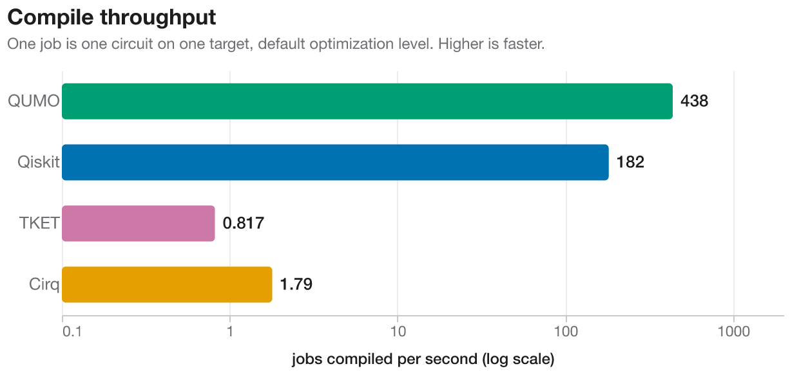
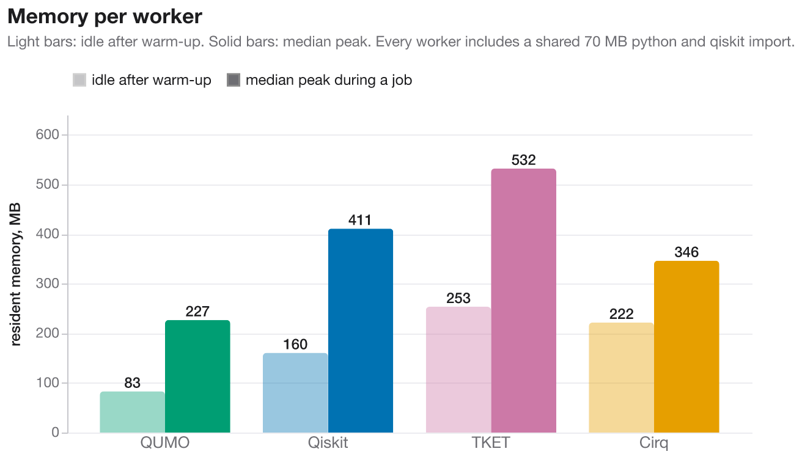
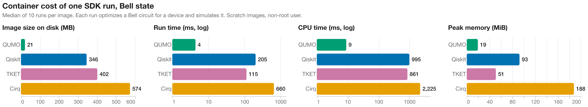
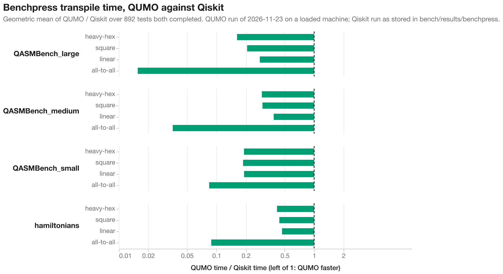
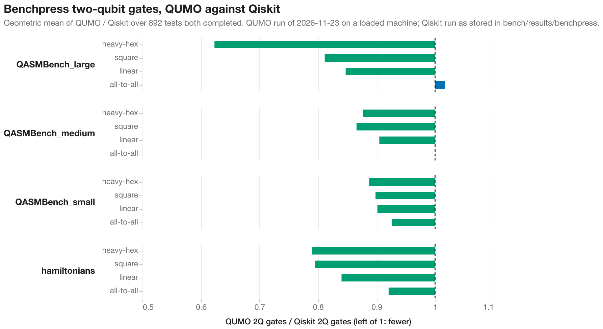
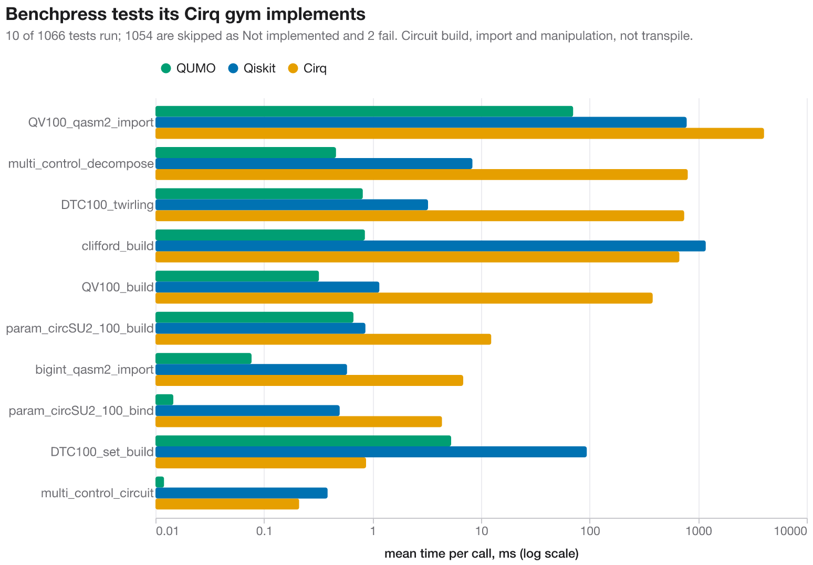

# QUMO

A hardware-neutral, AI-native Quantum software stack written in [Mojo](https://mojolang.org) (**QU**ANTUM+**MO**JO). One language, one binary: circuits, compiler, simulators, GPU Compute kernels, Error-Correction/Fault-Tolerance and an MCP server for AI Agents as interface. It takes the best ideas of Qiskit, TKET, CUDA-Q, PennyLane, Cirq, Q#, Amazon Braket and Qibo ([analysis](docs/ANALYSIS.md)).

No vendor is a default: targets are data, and presets are named by modality (superconducting, trapped ion, neutral atom, abstract).

## Who is it for

QUMO is a research project for people who want to learn, teach, experiment and build with Quantum + AI. Pick a route:

- **Learn** (students, hobby developers, teachers): the [tutorial](docs/TUTORIAL.md) goes from a Bell pair to Grover and VQE in about an hour, with every command and its expected output. Then try the five "Start here" [examples](examples/README.md).
- **Research**: the module reference in [docs/README.md](docs/README.md), [how to extend QUMO](docs/EXTENDING.md) (gates, noise channels, passes, decoders, targets, orchestrate), the benchmark reports with their disclosure sections, and [how to cite](#citing-and-contributing).
- **Work in Python**: `import qumo` gives a circuit builder, simulators, the compiler and the research drivers, with NumPy arrays out; the computation runs in the compiled Mojo core. [QUMO from Python](docs/PYTHON.md).
- **Coming from another SDK**: [From Qiskit, Cirq or PennyLane](docs/FROM_QISKIT.md) maps the calls you know to QUMO and shows how to move circuits across with OpenQASM.

## Quick start

Needs macOS 15+ (Apple silicon) or Linux, and [uv](https://docs.astral.sh/uv/).

```bash
git clone https://github.com/ANFAIA/QUMO.git && cd QUMO
make setup        # Mojo 1.2 toolchain in .venv
make cli          # build/qumo : CLI + MCP server
build/qumo run examples/foundations/bell.qasm --shots 1000 --seed 7
```

`make setup` installs about 850 MB into `.venv`; `make cli` takes about a minute. `make help` lists the build targets. Intel Macs and native Windows are not supported by the Mojo toolchain ([platforms](docs/GETTING_STARTED.md#platforms)).

The same binary compiles a circuit for a device, runs it on a noisy model of that device, and runs a small VQE:

```bash
build/qumo transpile examples/foundations/bell.qasm --target grid:2x2/sc_cz
build/qumo emulate examples/foundations/bell.qasm --target superconducting_grid:2x2 --shots 1000
build/qumo vqe "Z0 Z1 + 0.5*X0 + 0.5*X1"
```

`build/qumo --help` lists the commands and `build/qumo <command> --help` their options. An option a command does not know is an error, never ignored.

**From Python** ([docs/PYTHON.md](docs/PYTHON.md)): build the extension, install the `qumo` package, and write circuits with gate methods.

```bash
make py && pip install -e .       # or: uv pip install -e .
```

```python
import qumo

bell = qumo.Circuit(2).h(0).cx(0, 1).measure_all()
print(qumo.sample(bell, shots=1000))
```

```
1000 shots, 2 outcome(s), statevector:static
  11       504  0.5040  ####################
  00       496  0.4960  ####################
```

**From Mojo**, one import brings the names a first program needs. Save this as `my.mojo` and run `.venv/bin/mojo run -I . my.mojo` from the repository root; it prints `{"00": 496, "11": 504}`:

```mojo
from qumo import *


def main() raises:
    var c = Circuit(2)
    c.h(0)
    c.cx(0, 1)
    c.measure_all()
    print(sample_auto(c, 1000))
```

**From an LLM client**: `claude mcp add qumo -- /abs/path/to/QUMO/build/qumo mcp`.

Full install, update, GPU and hardware steps: [docs/GETTING_STARTED.md](docs/GETTING_STARTED.md).

## What is inside

| Module | What it does |
|---|---|
| `qumo.ir` | Circuit IR, `Program` (`while`, classical variables), symbolic parameters, OpenQASM 2/3 |
| `qumo.device` | `Target`: coupling graph, native basis, errors and durations, one-line specs (`parse_target`) |
| `qumo.compiler` | Compiles for any `Target`: text-spec pass pipelines ([docs/PASSES.md](docs/PASSES.md)), SABRE routing, KAK, AI transpiler |
| `qumo.sim` | State vector (SIMD, threads), stabilizer tableau, Pauli-frame sampler, density matrix |
| `qumo.noise` | `NoiseModel` from calibration data, randomized benchmarking, T1/Ramsey fits, readout mitigation (tensored and M3) |
| `qumo.gpu` | One Mojo source for NVIDIA, AMD and Apple GPUs |
| `qumo.exec` | Sampler/Estimator primitives, HEFT orchestration over CPU/GPU/QPU, resource estimation |
| `qumo.algorithms` | QFT, Grover, QPE, Trotter, UCCSD, gradients, VQE, QAOA, QML |
| `qumo.qec`, `qumo.ft` | Surface codes, decoders, detector error models; fault-tolerant programming |
| `qumo.ai`, `cli/` | JSON everywhere, stable `QM-Exxx` error codes with hints, MCP server, CLI |
| `qumo.core`, `qumo.net`, `qumo.bench`, `qumo.testing` | Support code: JSON and the seeded `Rng`, native HTTP/TLS client used by the hardware clients, benchmark circuit generators, `CheckLog` for machine-checked examples |
| `plugins/hardware` | Run compiled circuits on IBM Quantum and Quantinuum (dry-run by default) |
| `agents/` | AI agents that keep QUMO current: a Python package (`agents/qumo_agents`, on deepagents) and a native Mojo harness (`agents/mojo/`, from pull request #7) |

### What you need and what you can ignore

| Group | Directories | Needed for |
|---|---|---|
| Core | `qumo/` (the library), `cli/` (the `qumo` tool and MCP server), `python/` (the `qumo` Python package and the `qumo_py` extension under it), `tests/`, `docs/` | everything; this is all the tutorial uses |
| Optional | `examples/` (runnable, checked examples), `plugins/` (hardware providers), `agents/` (AI agents), `bench/` (benchmark harnesses and results) | learning by example, real devices, reproducing the numbers below |
| Research | `rl/` (native Mojo reinforcement-learning stack that trains the AI-transpiler models), `models/` (the trained models, loaded only by the AI transpiler) | the AI transpiler ([docs/AI_TRANSPILER.md](docs/AI_TRANSPILER.md)); nothing else depends on them |

## Results (Apple M5 unless noted)

| Area | Result |
|---|---|
| Qiskit Benchpress (1066 tests) | 1044 pass / 0 fail; 0.878x Qiskit's two-qubit gate count, 2.1x faster. [Details](docs/BENCHPRESS_RESULTS.md) |
| Neutral harness (11 topologies, 4 modalities) | 2Q ratio 0.928 vs Qiskit, 0.919 vs TKET, 0.803 vs Cirq; compiles 5-250x faster. [Details](docs/NEUTRAL_BENCHMARK_REPORT.md) |
| State vector, CPU (fp64) | 2.5-4.7x faster than Qiskit Aer from 16 to 26 qubits. [Details](docs/SIMULATION.md) |
| State vector, GPU (fp32) | Apple M5: 26-qubit layered circuit in 0.42 s. NVIDIA/AMD not yet measured with the current engine. [Details](docs/GPU.md) |
| QEC | Detector error model identical to Stim's; MWPM equal to PyMatching; frame sampling 3-4x Stim. [Details](docs/QEC.md) |
| VQE | H2 reaches the exact energy (error 1e-14); adjoint gradients 42x faster than parameter shift. [Details](docs/ALGORITHMS.md) |

The compiler was tuned on part of these benchmarks and the neutral harness was written by this project; read the disclosure sections of both reports. Most rows were measured around 2026-10-13 with Mojo 1.1 and Qiskit 2.5.2. The repository now pins Mojo 1.2 and the numbers have not been re-measured with it, so treat them as results of the older toolchain; each linked report states its own date and versions.

### Benchmark by SDK

The charts below do not come from Benchpress. They come from the neutral harness of this repository (`bench/neutral`: 704 circuit and target pairs at each of two optimization levels, QUMO, Qiskit, TKET and Cirq), mean of four sequential runs on a machine that was not idle (load average 3 to 3.5), so absolute times are indicative and the ratios are what to read. At the default level QUMO compiles 5.8x faster than Qiskit, 75x faster than Cirq and 195x faster than TKET (geometric mean over the pairs both compiled; 2.9x, 38x and 158x at the max level). Cirq compiled 379 of the 704 pairs, so its figures cover those only. Peak memory includes memory the worker process kept from earlier jobs, so compare SDKs with each other rather than reading it as the cost of one compile. Every figure is on one page, [bench/results/web/index.html](bench/results/web/index.html) (open it in a browser). Read the disclosure section of [docs/NEUTRAL_BENCHMARK_REPORT.md](docs/NEUTRAL_BENCHMARK_REPORT.md): this harness was written by this project.





Each SDK in its own container, built the way it would ship: a scratch image with only the interpreter or binary, the SDK and its libraries, run as a non-root user. Each run optimizes a Bell circuit for a device and simulates it; this is a measurement of this repository, not a Benchpress test. Time and CPU include starting the interpreter and importing the SDK. The Dockerfiles and the measuring script are in [docker/sdk-bell](docker/sdk-bell).



### Against Qiskit Benchpress

[Benchpress](https://github.com/Qiskit/benchpress) is Qiskit's compilation benchmark. Here it ran for QUMO and Qiskit only, on its default configuration (`fake_torino` and the all-to-all, square, heavy-hex and linear topologies), with QUMO called through a Benchpress gym of this repository. The charts show the geometric mean of QUMO / Qiskit over the 892 tests both completed, per suite and topology. The QUMO run of 2026-11-23 was taken on a machine that was not idle. The headline numbers are in the table above and in [docs/BENCHPRESS_RESULTS.md](docs/BENCHPRESS_RESULTS.md).





Benchpress's own Cirq gym implements very little: of its 1066 tests, 10 run (circuit build, QASM import and manipulation), 1054 are skipped as "Not implemented" and 2 fail, so there is no Cirq transpile comparison to draw from Benchpress. The 10 tests that do run, timed for QUMO, Qiskit and Cirq:



TKET has no Benchpress gym here. Benchpress published its own Qiskit against TKET run (560 tests; [bench/results/benchpress_published_qiskit_vs_tket.txt](bench/results/benchpress_published_qiskit_vs_tket.txt)); that is not a measurement of this repository.

## Documentation

The full map is [docs/README.md](docs/README.md). Common entry points:

- [Getting started](docs/GETTING_STARTED.md): install, CLI, MCP, Python, GPU, hardware.
- [Tutorial](docs/TUTORIAL.md): the first hour, step by step, in the CLI, Python and Mojo.
- [QUMO from Python](docs/PYTHON.md): the `qumo` package: circuits, simulation, compilation, research drivers.
- [From Qiskit, Cirq or PennyLane](docs/FROM_QISKIT.md): mapping table and OpenQASM round trips.
- [Extending QUMO](docs/EXTENDING.md): custom gates, noise channels, passes, decoders, targets.
- [Examples](examples/CATALOG.md): every example by category, with its original source.
- [Architecture](docs/ARCHITECTURE.md) and [framework analysis](docs/ANALYSIS.md).
- [AI-native interface](docs/AI_NATIVE.md), [error codes](docs/ERRORS.md), [llms.txt](llms.txt).
- [Agents](docs/AGENTS.md).
- [Contributing](CONTRIBUTING.md) and the [Mojo dialect guide](docs/MOJO_GUIDE.md); [changelog](CHANGELOG.md).

## Status

Research prototype (version string 0.1.0, no tagged release yet). APIs are small and documented but may change, and Mojo itself moves quickly. In progress: measuring the GPU engine on NVIDIA/AMD, parity with Qiskit on the densest 100+ qubit circuits, and real-hardware submission (the plugins are tested offline only).

## Citing and contributing

If you use QUMO in research, cite it with the metadata in [CITATION.cff](CITATION.cff) (GitHub shows a "Cite this repository" button) and state the commit you used: the project has no tagged release yet. To report a bug, propose a feature or submit a benchmark result, use the issue templates; [CONTRIBUTING.md](CONTRIBUTING.md) explains how to run the tests, add an example and report numbers reproducibly.

## License

[Apache License 2.0](LICENSE). See [NOTICE](NOTICE) for attribution; third-party benchmark circuits in `bench/neutral/circuits` keep their own licenses.
