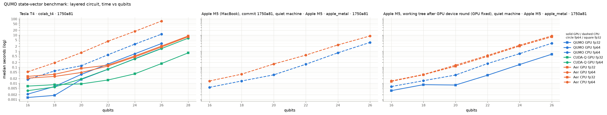
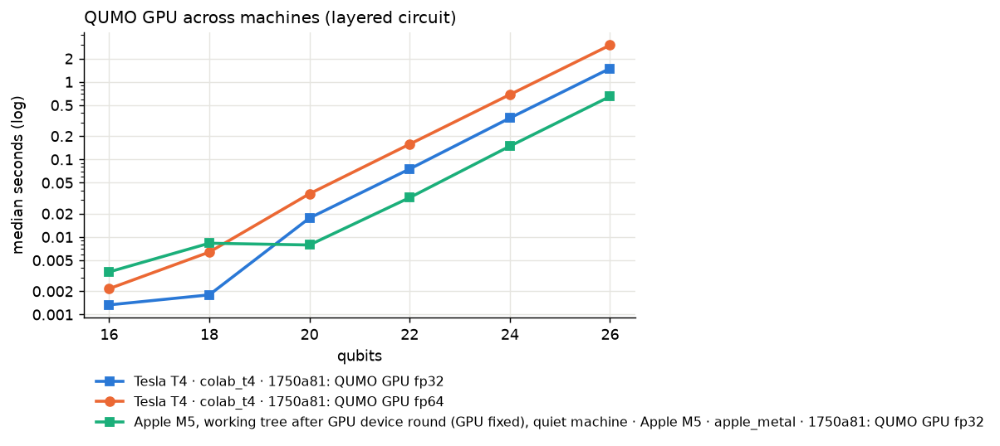

# QUMO benchmark comparison (3 runs)

Inputs: `qumo_bench_colab_t4_tesla-t4_20261012-235508.json`, `qumo_bench_apple_metal_apple-m5_20261012-232251.json`, `qumo_bench_apple_metal_apple-m5_20261012-232731.json`

## Machines

|  | Tesla T4 · colab_t4 · 1750a81 | Apple M5 (MacBook), commit 1750a81, quiet machine · Apple M5 · apple_metal · 1750a81 | Apple M5, working tree after GPU device round (GPU fixed), quiet machine · Apple M5 · apple_metal · 1750a81 |
|---|---|---|---|
| GPU | Tesla T4 | Apple M5 | Apple M5 |
| GPU memory | 15.0 GiB | 24.0 GiB | 24.0 GiB |
| GPU arch / driver | sm_75 / 580.82.07 | metal:4 / metal4 | metal:5 / metal4 |
| CPU | Intel(R) Xeon(R) CPU @ 2.00GHz x2 | Apple M5 x10 | Apple M5 x10 |
| host RAM | 12.7 GiB | 32.0 GiB | 32.0 GiB |
| OS | Ubuntu 24.04.4 LTS | macOS-26.5.2-arm64-arm-64bit | macOS-26.5.2-arm64-arm-64bit |
| Mojo / MAX | 1.1.0 / 26.6.0 | 1.1.0 / 26.6.0 | 1.1.0 / 26.6.0 |
| QUMO commit | 1750a81963 (dirty) | 1750a81963 (dirty) | 1750a81963 (dirty) |
| date (UTC) | 2026-10-12T23:55:08+00:00 | 2026-10-13T03:22:51+00:00 | 2026-10-13T03:27:31+00:00 |
| load avg start / end | [0.62, 0.41, 0.86] / [1.76, 1.82, 1.57] | [3.4, 3.5, 3.34] / [5.12, 5.15, 4.16] | [4.72, 5.05, 4.15] / [11.98, 7.14, 5.06] |
| config | colab_t4 | apple_metal | apple_metal |

## Suites

| suite | Tesla T4 · colab_t4 · 1750a81 | Apple M5 (MacBook), commit 1750a81, quiet machine · Apple M5 · apple_metal · 1750a81 | Apple M5, working tree after GPU device round (GPU fixed), quiet machine · Apple M5 · apple_metal · 1750a81 |
|---|---|---|---|
| gpu_check | ok (3 pass / 0 fail) | ok (3 pass / 0 fail) | - |
| sv_cpu | ok (6 rows) | ok (6 rows) | ok (6 rows) |
| sv_gpu | ok (18 rows) | failed | ok (9 rows) |
| baseline_aer | ok (20 rows) | ok (6 rows) | ok (12 rows) |
| baseline_cudaq | ok (14 rows) | - | - |
| baseline_lightning | skipped | skipped | - |
| neutral | ok (3 rows) | ok (3 rows) | - |
| tests | ok (test-gpu: 2/2) | partial (test-gpu: 1/2) | - |

## State-vector timings

Circuit family `layered`, median seconds:

| run | engine / device / precision | 16 q | 18 q | 20 q | 22 q | 24 q | 26 q | 28 q |
|---|---|---|---|---|---|---|---|---|
| Tesla T4 · colab_t4 · 1750a81 | QUMO GPU fp32 | 0.00133 | 0.00179 | 0.0175 | 0.0753 | 0.341 | 1.49 | - |
| Tesla T4 · colab_t4 · 1750a81 | QUMO GPU fp64 | 0.00216 | 0.00639 | 0.0361 | 0.157 | 0.685 | 2.97 | - |
| Tesla T4 · colab_t4 · 1750a81 | QUMO CPU fp64 | 0.0177 | 0.0593 | 0.125 | 0.6 | 2.73 | 11.4 | - |
| Tesla T4 · colab_t4 · 1750a81 | CUDA-Q GPU fp32 | 0.00676 | 0.00829 | 0.00929 | 0.0162 | 0.0391 | 0.17 | 0.786 |
| Tesla T4 · colab_t4 · 1750a81 | CUDA-Q GPU fp64 | 0.00353 | 0.00596 | 0.0188 | 0.0761 | 0.332 | 1.45 | 6.44 |
| Tesla T4 · colab_t4 · 1750a81 | Aer GPU fp32 | 0.0273 | 0.0364 | 0.0857 | 0.136 | 0.5 | 2.07 | 8.82 |
| Tesla T4 · colab_t4 · 1750a81 | Aer GPU fp64 | 0.0214 | 0.0269 | 0.0473 | 0.12 | 0.438 | 1.82 | 7.88 |
| Tesla T4 · colab_t4 · 1750a81 | Aer CPU fp64 | 0.0524 | 0.19 | 0.809 | 4.15 | 17 | 74.4 | - |
| Apple M5 (MacBook), commit 1750a81, quiet machine · Apple M5 · apple_metal · 1750a81 | QUMO CPU fp64 | 0.00569 | 0.0141 | 0.0338 | 0.154 | 0.793 | 3.5 | - |
| Apple M5 (MacBook), commit 1750a81, quiet machine · Apple M5 · apple_metal · 1750a81 | Aer CPU fp64 | 0.0141 | 0.0374 | 0.16 | 0.571 | 2.44 | 8.83 | - |
| Apple M5, working tree after GPU device round (GPU fixed), quiet machine · Apple M5 · apple_metal · 1750a81 | QUMO GPU fp32 | 0.00355 | 0.00831 | 0.00789 | 0.0322 | 0.148 | 0.648 | - |
| Apple M5, working tree after GPU device round (GPU fixed), quiet machine · Apple M5 · apple_metal · 1750a81 | QUMO CPU fp64 | 0.00635 | 0.0147 | 0.0329 | 0.171 | 0.705 | 3.11 | - |
| Apple M5, working tree after GPU device round (GPU fixed), quiet machine · Apple M5 · apple_metal · 1750a81 | Aer CPU fp32 | 0.0133 | 0.0342 | 0.116 | 0.478 | 2.09 | 7.81 | - |
| Apple M5, working tree after GPU device round (GPU fixed), quiet machine · Apple M5 · apple_metal · 1750a81 | Aer CPU fp64 | 0.0142 | 0.0357 | 0.135 | 0.543 | 2.35 | 8.92 | - |

## Speed-ups

**Tesla T4 · colab_t4 · 1750a81** - fp64 series, speed-up vs Aer CPU fp64 (x):

| series | 16 q | 18 q | 20 q | 22 q | 24 q | 26 q |
|---|---|---|---|---|---|---|
| QUMO GPU fp64 | 24.32 | 29.78 | 22.42 | 26.39 | 24.79 | 25.01 |
| QUMO CPU fp64 | 2.96 | 3.21 | 6.49 | 6.92 | 6.22 | 6.52 |
| CUDA-Q GPU fp64 | 14.85 | 31.91 | 43.13 | 54.55 | 51.20 | 51.43 |
| Aer GPU fp64 | 2.45 | 7.07 | 17.09 | 34.66 | 38.81 | 40.95 |

**Tesla T4 · colab_t4 · 1750a81** - fp32: no 'Aer CPU fp32' series in this run, so no fp32 speed-ups (QUMO GPU fp32, CUDA-Q GPU fp32, Aer GPU fp32). Add "fp32" to `baseline_aer.precisions_cpu` in the preset for an fp32 CPU reference.

**Apple M5 (MacBook), commit 1750a81, quiet machine · Apple M5 · apple_metal · 1750a81** - fp64 series, speed-up vs Aer CPU fp64 (x):

| series | 16 q | 18 q | 20 q | 22 q | 24 q | 26 q |
|---|---|---|---|---|---|---|
| QUMO CPU fp64 | 2.48 | 2.65 | 4.74 | 3.71 | 3.08 | 2.53 |

**Apple M5, working tree after GPU device round (GPU fixed), quiet machine · Apple M5 · apple_metal · 1750a81** - fp64 series, speed-up vs Aer CPU fp64 (x):

| series | 16 q | 18 q | 20 q | 22 q | 24 q | 26 q |
|---|---|---|---|---|---|---|
| QUMO CPU fp64 | 2.23 | 2.44 | 4.10 | 3.18 | 3.33 | 2.87 |

**Apple M5, working tree after GPU device round (GPU fixed), quiet machine · Apple M5 · apple_metal · 1750a81** - fp32 series, speed-up vs Aer CPU fp32 (x):

| series | 16 q | 18 q | 20 q | 22 q | 24 q | 26 q |
|---|---|---|---|---|---|---|
| QUMO GPU fp32 | 3.75 | 4.11 | 14.74 | 14.86 | 14.08 | 12.04 |

## QEC Pauli-frame sampling (QUMO GPU vs CPU)

| run | code | d | shots | CPU s | GPU s | speed-up |
|---|---|---|---|---|---|---|
| Tesla T4 · colab_t4 · 1750a81 | surface_z | 3 | 1000000 | 0.0207 | 0.00532 | 3.89 |
| Tesla T4 · colab_t4 · 1750a81 | surface_z | 5 | 1000000 | 0.0726 | 0.0304 | 2.39 |
| Tesla T4 · colab_t4 · 1750a81 | surface_z | 7 | 1000000 | 0.214 | 0.0993 | 2.16 |
| Tesla T4 · colab_t4 · 1750a81 | surface_z | 3 | 1000000 | 0.015 | 0.00479 | 3.14 |
| Tesla T4 · colab_t4 · 1750a81 | surface_z | 5 | 1000000 | 0.072 | 0.0302 | 2.39 |
| Tesla T4 · colab_t4 · 1750a81 | surface_z | 7 | 1000000 | 0.209 | 0.0981 | 2.13 |
| Apple M5, working tree after GPU device round (GPU fixed), quiet machine · Apple M5 · apple_metal · 1750a81 | surface_z | 3 | 1000000 | 0.00497 | 0.00903 | 0.55 |
| Apple M5, working tree after GPU device round (GPU fixed), quiet machine · Apple M5 · apple_metal · 1750a81 | surface_z | 5 | 1000000 | 0.0236 | 0.0454 | 0.521 |
| Apple M5, working tree after GPU device round (GPU fixed), quiet machine · Apple M5 · apple_metal · 1750a81 | surface_z | 7 | 1000000 | 0.0655 | 0.12 | 0.544 |

## Compiler subset (hardware-neutral benchmark)

| run | SDK | jobs | ok | invalid / incorrect / error / timeout | unsupported | median compile ms | median 2q gates | mean ESP |
|---|---|---|---|---|---|---|---|---|
| Tesla T4 · colab_t4 · 1750a81 | qiskit | 90 | 90 | 0 | 0 | 9.89 | 6 | 0.9010 |
| Tesla T4 · colab_t4 · 1750a81 | qumo | 90 | 90 | 0 | 0 | 0.8 | 6 | 0.9132 |
| Tesla T4 · colab_t4 · 1750a81 | tket | 90 | 90 | 0 | 0 | 140 | 6 | 0.9068 |
| Apple M5 (MacBook), commit 1750a81, quiet machine · Apple M5 · apple_metal · 1750a81 | qiskit | 90 | 90 | 0 | 0 | 4.07 | 6 | 0.9010 |
| Apple M5 (MacBook), commit 1750a81, quiet machine · Apple M5 · apple_metal · 1750a81 | qumo | 90 | 90 | 0 | 0 | 0.35 | 6 | 0.9132 |
| Apple M5 (MacBook), commit 1750a81, quiet machine · Apple M5 · apple_metal · 1750a81 | tket | 90 | 90 | 0 | 0 | 70 | 6 | 0.9067 |

## Problems and skipped parts

- **Tesla T4 · colab_t4 · 1750a81 / baseline_lightning** (skipped): QM-E965: lightning: No module named 'pennylane' (interpreter bench/.venv/bin/python). Hint: install the baseline in the interpreter given by the config (see docs/BENCHMARKING_ON_CLOUD_GPUS.md).
- **Apple M5 (MacBook), commit 1750a81, quiet machine · Apple M5 · apple_metal · 1750a81 / sv_gpu** (failed): QM-E968: Unhandled exception caught during execution: At max/mojo/max/gpu/host/_device_context_extras.mojo:170:17: Failed to create compute pipeline state (GPU machine code generation): Internal compiler error. Hint: rerun the command recorded in `commands` to see the full error (MODULAR_DEBUG=device-sync-mode for GPU errors).
- **Apple M5 (MacBook), commit 1750a81, quiet machine · Apple M5 · apple_metal · 1750a81 / baseline_lightning** (skipped): QM-E965: lightning: No module named 'pennylane' (interpreter bench/.venv/bin/python). Hint: install the baseline in the interpreter given by the config (see docs/BENCHMARKING_ON_CLOUD_GPUS.md).
- **Apple M5 (MacBook), commit 1750a81, quiet machine · Apple M5 · apple_metal · 1750a81 / tests** (partial): QM-E969: 1 test file(s) failed. Hint: rerun the failing test by hand: .venv/bin/mojo run -I . <file>.

